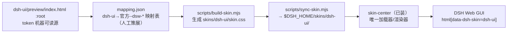

# dsh-theme 架构

> 这份文档是「改动该落在哪」的地图。

## 用途

把 dsh-ui 设计规范做成 skin-center 皮肤（纯资产目录），在 DSH Web GUI 上一键应用/切回。

## 结构

## 组件

- **skins/dsh-ui/**：皮肤源目录（skin.json v2 清单 + 生成的 skin.css + preview/ 预览图）。纯资产，无任何可执行接线。
- **mapping.json**：唯一手工维护物——dsh-ui token 到官方 --dsw-* alias 的语义映射（明暗双套）。
- **scripts/build-skin.mjs**：preview :root + mapping.json → skin.css。保证「零手抄」。
- **scripts/sync-skin.mjs**：皮肤源 → $DSH_HOME/skins/dsh-ui/（目录册收录点）。
- **docs/spec.md / docs/milestones.md**：范围与验收的唯一权威。

## 数据流

视觉数值只在 dsh-ui 改 → 重跑 build + sync → 皮肤中心里重新应用。反向不允许：skin.css 发现映射缺口 → 改 mapping.json，不改生成物。

## 维护规则

- skin.css 是生成物，严禁手改（改 mapping.json 重跑）。
- 非平凡决策记 .agents/notes/（规范同 dsh-ui）。
