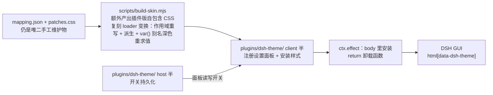

# dsh-theme 架构

> 这份文档是「改动该落在哪」的地图。

## 用途

把 dsh-ui 设计规范做成 DSH Web GUI 的主题：M1–M4 是 skin-center 皮肤（纯资产目录），一键应用/切回；**M5 起是自研 bundle 插件**（自带设置面板开关，本地自用先行，**在建未验收**）。两条路并存，视觉数值同源。

## 结构

```mermaid
flowchart LR
    ROOT["dsh-ui/preview/index.html :root<br/>token 机器可读源"] --> MAP["mapping.json<br/>dsh-ui→官方--dsw-* 映射表（人工策展）"]
    MAP --> GEN["scripts/build-skin.mjs<br/>生成 skin.css：L1 token + --dsh-* 变量全集<br/>含两条守卫"]
    PATCH["skins/dsh-ui/patches.css<br/>L2/L3 层（人工维护）"] -.->|构建期校验 var(--dsh-*) 引用| GEN
    GEN --> SYNC["scripts/sync-skin.mjs<br/>→ $DSH_HOME/skins/dsh-ui/"]
    PATCH --> SYNC
    SYNC --> SC["skin-center（已装）<br/>唯一加载器/渲染器"]
    SC --> GUI["DSH Web GUI<br/>html[data-dsh-skin=dsh-ui]"]
```

### 插件期结构（M5，在建）

纯皮肤链原样保留；插件期另起一条注入链，视觉数值同源、两条链互不消费。



- **host 半**：只管开关的落盘（官方 settings 服务优先），不做 UI；开关状态由它持有。
- **client 半**：注册设置面板（`ctx.slots.inject("settings.section", …)`，React 组件）+ 注入/卸载样式 + **语义锚点适配器**（MutationObserver 给 shell DOM 打 `data-dsh-part`/`data-dsh-surface`，只覆盖 theme.css 实需的 3 个锚点——patches.css 的 3 条 L2 规则靠这些属性选择器，纯皮肤期由 skin-center 代打，插件期必须自带）。client 文件**顶层零声明**——所有 `const`/`let`/`function` 必须进 factory 函数体或 IIFE，否则与同批次其他包共享作用域、重名即整批解析失败。
- **`ctx.effect` 正确形态**：effect body 里做安装、`return` 卸载函数；卸载函数直接当 body 传会被立即执行，等于装上就撤，且平台不报错（M1 即栽在这里，见 HANDOFF.md §3.4）。
- **层叠**：官方 token 挂 `body{--dsw-*}`，插件用 `html[attr] body` 稳定胜出；卸载 = 删 `<style>` + 摘根属性。

## 组件

- **skins/dsh-ui/**：皮肤源目录（skin.json v2 清单 + 生成的 skin.css + 人工维护的 patches.css + preview/ 预览图）。纯资产，无任何可执行接线。
- **mapping.json**：手工维护物之一——dsh-ui token 到官方 --dsw-* alias 的语义映射（明暗双套，面向 299 官方契约）。
- **skins/dsh-ui/patches.css**：手工维护物之二——L2 语义属性规则（data-dsh-surface/part）、L3 最小兜底（class* / 全局）、以及**非 alias 命名空间**（shell 实际消费的 --dsw-specific-* / --dsw-radius-*）的重绑定。规则一律引用 var(--dsh-*) 或 var(--dsw-*)，不写死数值。
- **scripts/build-skin.mjs**：preview :root + mapping.json → skin.css，并额外发射 --dsh-* 变量全集（明暗双套）供 patches.css 引用。两条守卫：patches.css 引用 preview :root 里不存在的变量 → 报错；preview :root 与 shell 自有变量重名 → 报错。
- **scripts/sync-skin.mjs**：皮肤源 → $DSH_HOME/skins/dsh-ui/（含子目录，目录册收录点）。
- **plugins/dsh-theme/**（M5 在建）：自研 bundle 插件，host/client 双半。host 半 = 开关持久化；client 半 = 样式注入 + 设置面板，顶层零声明（须包在 factory/IIFE 内）。详见上文「插件期结构」。
- **docs/spec.md / docs/milestones.md**：范围与验收的唯一权威。

## 数据流

视觉数值只在 dsh-ui 改 → 重跑 build + sync → 皮肤中心里重新应用。反向不允许：发现视觉缺口时，色板类改 mapping.json、组件类改 patches.css，绝不改生成物。

**两条链并存**：纯皮肤走 build → sync → skin-center 注入；插件走 build（插件版自包含 CSS）→ client 半自注入。两者不互相消费，共用同一份 mapping.json / patches.css / 同一套验收基线。同一时刻只允许一条生效：插件启用时皮肤卡须退到官方默认，防双注入。

## 维护规则

- skin.css 是生成物，严禁手改（改 mapping.json 重跑）；插件版 CSS 同理（build-skin.mjs 额外产出，同样是生成物）。
- patches.css 是手写的，但它**不许出现裸 hex/尺寸**：一律 var(--dsh-*)（preview :root 的值由构建发射）或 var(--dsw-*)（官方契约 token）。
- 皮肤中心会把 --dsw-alias-* 派生到非 alias 命名空间；shell 组件实际消费的是非 alias 名。改组件观感优先查「shell 消费哪个 token」，能用 token 表达就不写选择器。
- 非平凡决策记 .agents/notes/（规范同 dsh-ui）。
