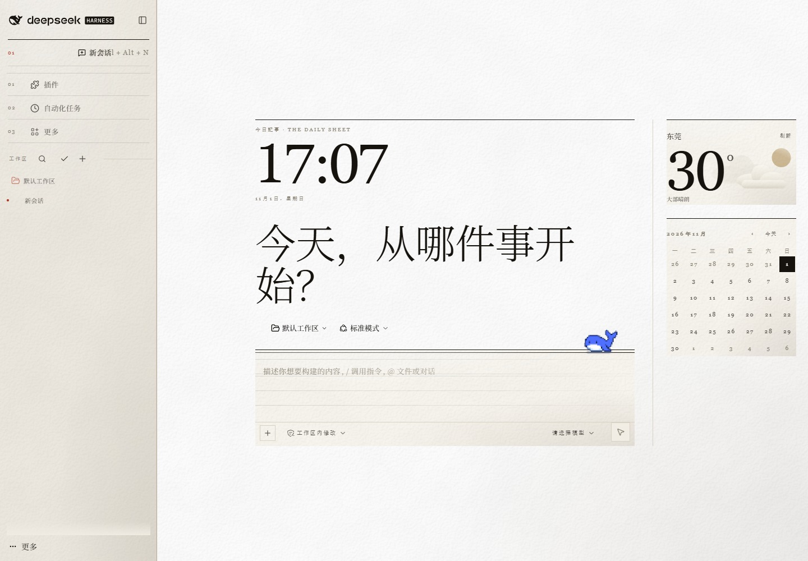
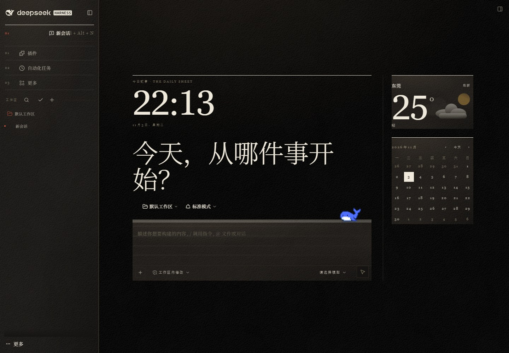

# dsh-theme · 压印（IMPRINT）

> 把 **DeepSeek Harness** 的界面排成一本每天出的刊物：纸、灯、墨。
>
> 所有版面只用发丝线、页码与留白组织，不用圆角卡片与柔和阴影。

| 浅色 · 纸 | 深色 · 炭纸 |
|---|---|
|  |  |

---

## 它是什么

不是"给聊天框换个配色"，而是一套**排版语法**：

- **纸**：程序化生成的纸纹（纸齿 + 云斑）与光照（左上高光、右下暗角）。纹理画在各表面自身的背景层，**文字之上没有任何叠加层**——纸感来自材质，不来自盖在字上的噪点。
- **灯**：浅色 `multiply` 压暗、深色 `screen` 提亮，同一套纸在两套主题下都成立。
- **墨**：中文走思源宋体（可变字重 300 / 350 / 400 三档撑层级），拉丁与数字走 Georgia（拉开字距），等宽只留给代码与工具日志。
- **形**：圆角归零、阴影归零，层次只由**发丝线与留白**表达；朱砂只出现在四处（当前目录项、日历今日、发送键、引用竖线）。

## 界面特性

### 新会话 · 报头版
刊名小标 + 96px 时刻 + 72px 衬线主标题；输入卡是"双墨线 + 横格稿纸"（格线节距 = 行高，每条线垫在字下面）；右栏是页边注式的气象读数与月历。

### 会话区 · 报刊正文
消息带页边注（`Nº 03 / 你`、`— / 助手`），正文 15.5 / 31 两端对齐；工具调用降为等宽日志行；消息流末尾留白，滚到底时不会压在输入卡的墨线上。

### 侧栏 · 目录页
01–04 序号 + 发丝线分隔的目录式导航；会话行用衬线标题，选中靠左侧朱砂方点而不是色块。

### 账户抽屉
侧栏底部原本散落的插件条目（远端入口、今日消费卡等）收进账号菜单：点账号行弹出，排在原生菜单上方，条目照旧可点。

### 输入卡
三行恒高、单行工具带、粘贴长文内滚不抖；卡顶双墨线是版面里最重的一根线。

### Deepy
96px 像素精灵，随会话事件切换 8 种状态（待机 / 思考 / 工具 / 达成 / 异常 …），首屏只加载首帧，其余随用随拉。

### 图标层
把宿主原生图标按几何指纹映射为 Lucide 线性图标，非破坏式替换，开关关闭即原样还原。

## 安装

两种形态：**插件**（推荐，含 Deepy / 图标层 / 设置面板）与**纯皮肤卡**（只有 CSS，无代码执行）。

### 方式 A · 作为 Bundle 插件

1. 在本仓库根目录运行 `node scripts/build-skin.mjs`，确认插件样式产物已生成；
2. 桌面端在 **Plugins** 页面添加本仓库的 `plugins/dsh-theme` 包目录。独立 CLI profile 也可使用插件管理命令（路径必须是绝对路径）：

   ```bash
   dsh plugin --profile <profile> add "file:/absolute/path/to/dsh-theme/plugins/dsh-theme"
   ```

   管理器会读取包自带的 `cordis.patch.yml` 并选择 bundle，无需手工编辑 profile 的依赖或 bundles。本地开发需要保留源码链接时，把 `file:` 换成 `link:`。
3. 按管理结果等待热应用；若提示 `restart-required`，重启 DSH。随后打开 **设置 → dsh-theme 主题**，开关即时生效，状态跨重启保留。

> 插件激活时会把皮肤中心切回官方默认，避免双重注入。与 `dsh-claude-style` 存在全屏视觉冲突，二者只开其一。

### 方式 B · 作为皮肤卡

1. 启用官方 **skin-center**；
2. 把 `skins/dsh-ui/` 复制到用户皮肤目录（Windows 默认 `%USERPROFILE%\.dsh\skins\dsh-ui`）；
3. 设置 → 皮肤 → **dsh-ui Design Spec** → 应用。

## 本地开发

> 视觉数值单一来源：`design/tokens.css`（由 `design/preview.html` 的 token 清单机械生成）。
> 手工维护物只有两件：`mapping.json`（官方 alias 映射）与 `skins/dsh-ui/patches.css`（版式与组件层）。

```bash
# 样式构建（生成 skin.css 与插件版 theme.css，并跑守卫：var 引用 / 保留变量 / noise 合法性）
node scripts/build-skin.mjs

# 只改了设计稿的 token 时，先重生成 tokens.css
node scripts/build-skin.mjs --regen-tokens

# 纸纹贴图（程序化 SVG 纸齿 / 云斑写回设计稿，再重生成 token）
node scripts/build-paper.mjs --write

# 图标数据集与指纹映射
node scripts/build-icons.mjs && node scripts/build-icon-map.mjs

# Deepy 精灵图降采样
node scripts/build-deepy.mjs

# 同步皮肤卡到本地运行时目录
node scripts/sync-skin.mjs
```

### 测试

```bash
node plugins/dsh-theme/test/state-machine.test.mjs
node plugins/dsh-theme/test/render-layer.test.mjs
node plugins/dsh-theme/test/hooks-layer.test.mjs
node plugins/dsh-theme/test/icon-layer.test.mjs
node plugins/dsh-theme/test/composer-deepy.test.mjs
node plugins/dsh-theme/test/host.test.mjs
node plugins/dsh-theme/test/today.test.mjs
```

真机验收：隔离 web profile + Playwright（`.agents/shots/_imprint_verify.py`，15 项：纸色 / 报头字号 / 页边注 / 气泡清除 / 正文行高 / console 零错误等）。

## 目录

| 路径 | 说明 |
|---|---|
| `design/` | 设计源 `preview.html` 与机器可读 token `tokens.css` |
| `plugins/dsh-theme/` | Bundle 插件：host 半（持久化 / 天气路由）+ client 半（样式注入 / Deepy / 图标 / 账户抽屉） |
| `skins/dsh-ui/` | 纯皮肤卡资源（`skin.css` + `patches.css`） |
| `scripts/` | 构建、守卫与素材生成 |
| [ARCHITECTURE.md](ARCHITECTURE.md) | 技术与分层契约 |
| [docs/milestones.md](docs/milestones.md) | 里程碑与已验证边界 |
| [HANDOFF.md](HANDOFF.md) | 交接与隔离实例验收方法 |

## 许可与致谢

- 图标资源：[Lucide Icons](https://lucide.dev/)（ISC）。
- 吉祥物 **Deepy** 像素素材版权归原作者所有。
- 纸面材质的分层思路受 [rinDBeans/dsh-nocturne](https://github.com/rinDBeans/dsh-nocturne) 的「albedo × irradiance」启发；本项目用程序化 SVG 滤镜在纯 CSS 层实现，无 WebGL 依赖。
