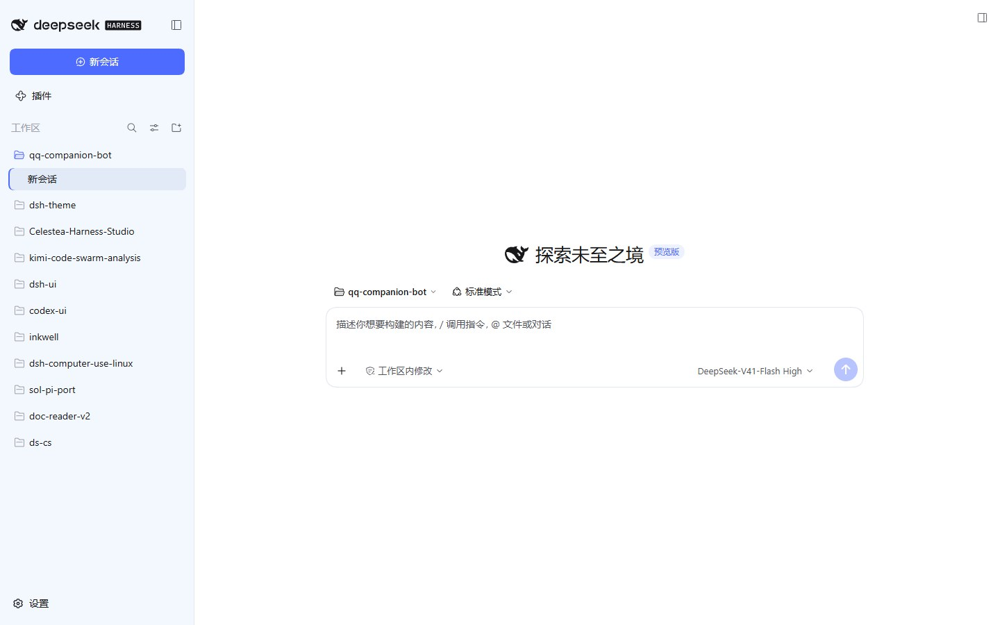
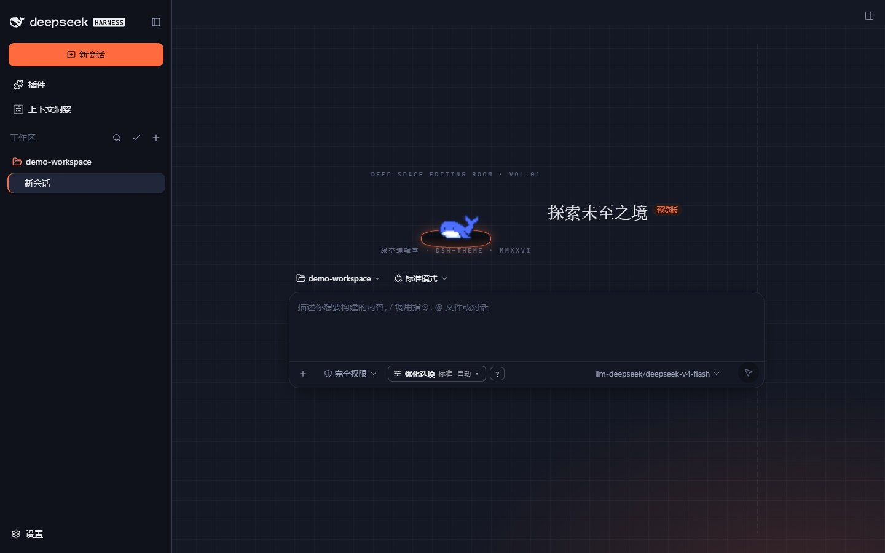

# dsh-ui 皮肤（dsh-theme）

把 [dsh-ui 设计规范](E:/dsh-ui) 做成 DSH Web GUI 的皮肤：蓝调画布 + 纯白卡片、DeepSeek 品牌蓝、明暗双套。**一键应用，一键切回官方默认**，不刷新页面、不重启。

| 浅色 | 深色 |
|---|---|
|  |  |

---

## 怎么用

### 启用条件（两条，缺一不可）

1. **皮肤中心（skin-center）保持启用** —— 它是唯一的皮肤加载器/渲染器。
2. **dsh-claude-style 必须关闭** —— 两者都是整体改造型皮肤，同时开启会互相覆盖。

### 应用 / 试穿 / 切回

设置 → 皮肤 → 找到「**dsh-ui Design Spec**」卡片：

- **试穿**：即时预览，退出设置即还原，不动你的持久设置。
- **应用**：持久生效（当场生效，无需刷新或重启）。
- **切回**：点「官方默认」卡的「恢复默认」，同样当场还原。

### 换机器 / 首次安装

把整个 `skins/dsh-ui/` 目录拷到 `$DSH_HOME/skins/`（本机 = `C:\Users\pass\.dsh\skins\`），刷新 GUI 即出现在皮肤列表里。

---

## 它改了什么

皮肤是**纯资产目录**——不写插件、不接任何可执行代码，只有 CSS 与图片：

- **L1 色板层**：91 个官方 `--dsw-*` token 重映射（明暗双套），值全部取自 dsh-ui 规范的 `:root`。
- **L2/L3 组件层**：输入卡（20px 圆角白卡 + 1px 描边 + 聚焦品牌色）、侧栏（纯色衬底 + subtle 分隔线）、新建会话（实心主按钮）、会话选中态（底色 + 2px 品牌色左缘指示条）、设置面板圆角、聚焦环。
- 明暗两套都覆盖；深色不是浅色的反相，层次靠明度差。

## 已知缺口

| 缺口 | 说明 |
|---|---|
| 模型档位 pill | 规范里档位选择器是浅蓝胶囊，GUI 里该控件只有哈希类名、无语义属性可锚——按契约纪律不硬上，待上游补 `data-dsh-part`。 |
| 排版层（font） | 181 个 font token 未接管，GUI 仍是官方字号体系（官方有 72 处 `font:` 简写消费，局部映射会自相矛盾）。 |
| loader 派生区依赖 | 组件层依赖皮肤中心把 `--dsw-alias-*` 派生到非 alias 命名空间的行为；loader 升级后需重跑验收脚本回归。 |
| 卡片预览图 | 1440×900 缩到卡片尺寸后细节偏小，可考虑更聚焦的构图。 |

---

## 自己改 / 重新构建

视觉数值的唯一来源是 **dsh-ui 的 `preview/index.html` 的 `:root`**；`skin.css` 是生成物，**禁止手改**。

```bash
# ① 改视觉：色板类改 mapping.json，组件类改 skins/dsh-ui/patches.css
# ② 构建（从 preview :root 生成 skin.css，并校验 patches.css 的 var() 引用）
node scripts/build-skin.mjs
# ③ 同步上架（→ $DSH_HOME/skins/dsh-ui/，含 preview/ 子目录）
node scripts/sync-skin.mjs
```

两个手工维护物都**只准用 `var(--dsh-*)` / `var(--dsw-*)` 引用数值**，不写裸 hex/尺寸：`mapping.json` 管 L1 契约 token，`patches.css` 管 L2/L3 组件规则与非 alias 命名空间重绑定。

## 验证

- **快层（秒级，随时跑）**：`node scripts/build-skin.mjs` —— 顺带校验 `patches.css` 引用存在、与 shell 自有变量不重名。
- **全量层（隔离实例 + Playwright）**：`.agents/shots/_m2_verify.py`（91 token × 明暗全量断言）、`_m3_verify.py`（组件层断言）、`_m3_compare.py`（与 dsh-ui preview 基准逐项对照）。完整起停流程见 [HANDOFF.md](HANDOFF.md) §5。

---

## 目录与文档

| 路径 | 是什么 |
|---|---|
| `skins/dsh-ui/` | 皮肤源目录（skin.json 清单 + 生成的 skin.css + 手写 patches.css + preview/ 预览图） |
| `mapping.json` | L1 映射表（dsh-ui token → 官方 `--dsw-*`，人工策展） |
| `scripts/` | 构建与同步脚本 |
| [AGENTS.md](AGENTS.md) | 项目规矩与 Quick Commands |
| [ARCHITECTURE.md](ARCHITECTURE.md) | 结构地图（改动该落在哪） |
| [.agents/notes/](.agents/notes/) | 决策史（目录树即索引） |
| [docs/spec.md](docs/spec.md) · [docs/milestones.md](docs/milestones.md) | 范围与里程碑（验收权威） |
| [HANDOFF.md](HANDOFF.md) | 交接文档（当前状态 + 施工要点 + 验收方法论） |
